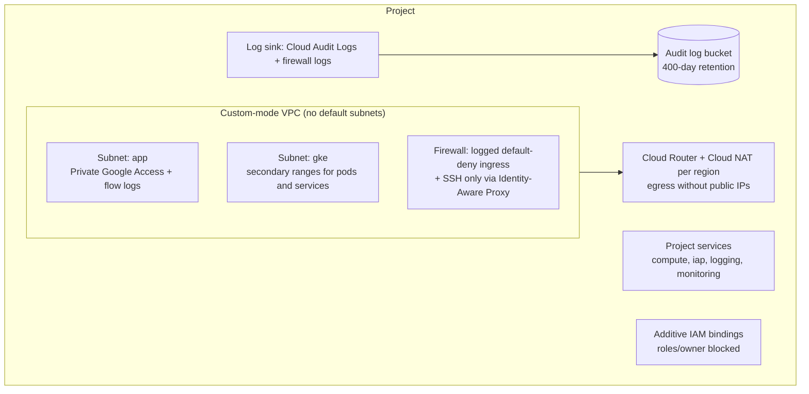

# terraform-gcp-foundation

[](https://github.com/ebrahimsidat/terraform-gcp-foundation/actions/workflows/ci.yml)


Reusable Terraform modules for a secure **Google Cloud project foundation**: a private VPC network,
centralised audit logging, least-privilege IAM and API enablement. The design follows Google Cloud
Architecture Framework security practices and is suitable as the base layer for workloads such as GKE,
Compute Engine and managed databases.

## What it builds



| Module | Purpose | Key security controls |
|---|---|---|
| [`network`](modules/network) | Custom VPC, subnets, Cloud Router and NAT, firewall baseline | No auto subnets; Private Google Access; VPC flow logs; logged default-deny ingress; SSH restricted to the IAP range and tagged instances; NAT so instances need no public IPs |
| [`logging`](modules/logging) | Central audit log bucket, sink and Data Access audit logs | Admin and data access logging for all services; configurable retention; dedicated sink identity |
| [`iam`](modules/iam) | Additive project IAM bindings from a role-to-members map | Members validated by type; `roles/owner` rejected; bindings never overwrite policy managed elsewhere |
| [`project-services`](modules/project-services) | Enables required Google Cloud APIs | APIs are not disabled on destroy, avoiding accidental outages |

## Usage

```hcl
module "network" {
  source = "github.com/ebrahimsidat/terraform-gcp-foundation//modules/network?ref=v1.0.0"

  project_id   = "my-project-id"
  network_name = "core-vpc"

  subnets = {
    "app-nane1" = {
      region        = "northamerica-northeast1"
      ip_cidr_range = "10.10.0.0/20"
    }
  }
}
```

A complete composition of all four modules is in [`examples/foundation`](examples/foundation):

```bash
cd examples/foundation
cp terraform.tfvars.example terraform.tfvars    # set project_id, subnets and IAM groups
terraform init
terraform plan -out=foundation.plan
terraform apply foundation.plan
```

## Inputs and validation

Every variable is typed, documented and, where it matters, validated at plan time, for example:

- network names must be valid RFC 1035 names and subnet ranges valid CIDR blocks
- flow-log sampling must be between 0 and 1, and log retention between 1 and 3650 days
- IAM members must be `user:`, `group:`, `serviceAccount:` or `domain:` principals, and `roles/owner` is refused

See each module's `variables.tf` for the full list of inputs and defaults, and `outputs.tf` for outputs.

## Quality gates

Continuous integration runs on every push and pull request:

| Check | Tool |
|---|---|
| Formatting | `terraform fmt -check -recursive` |
| Validation of every module and the example | `terraform init -backend=false && terraform validate` |
| Linting (recommended preset, documented variables and outputs, naming) | `tflint --recursive` |
| Infrastructure security scan | Checkov |

## Design notes

Decisions such as additive IAM, the explicit default-deny rule and per-region NAT are explained in
[docs/design.md](docs/design.md).

## License

Released under the [MIT License](LICENSE). © 2026 Ebrahim Sidat.
